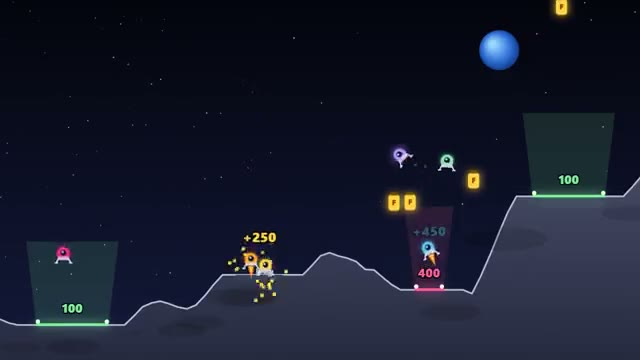

# Lander Rush

Race rival rockets to land softly on tiny pads. A multiplayer starter game from [Multiplayer Agent](https://multiplayeragent.com): 2D, versus, 2–8 players, with bots that fill empty seats.

## How it plays

Thrust and tilt your lander over a cratered moon and touch down gently on a glowing pad. Smaller pads pay more, and each pad jumps away once someone lands on it. Grab fuel cans, bump rivals off course, and top the score when the time runs out.

**Controls:** ← → to tilt, ↑ or Space to thrust; on touch, the tilt buttons and THRUST.

## Make it yours in the Game Builder

Open the [Game Builder](https://multiplayeragent.com), choose **Start from a starter game** and pick Lander Rush. It opens as version 1 in your studio, ready to play and publish. Then ask for changes, for example:

- Add wind that pushes the landers sideways
- Make it a cargo run: pick up a crate and drop it on a pad
- Turn the moon into a red Mars with dust storms

## Run it yourself

1. Get a free publishable key (`pk_…`) at [multiplayeragent.com](https://multiplayeragent.com).
2. In `index.html`, put it in place of `pk_REPLACE_ME` in the `MP_CONNECT` block.
3. Open `index.html` in a browser. No build step and no server needed.

Without a key it still runs, offline against bots.

## How it is built

- One `index.html`. The comment at the top of the script maps the code and explains the multiplayer.
- **Live sync:** Every lander flies for everyone at once, and you can bump into each other.
- **Host-run rules:** The host's browser owns the pads, the fuel cans and the scores, and checks every landing. If it leaves, the next player takes over.
- **Bots:** Bots fill empty seats, race for pads and grab fuel.
- **Leaderboard:** Each player's best round score.
- `?attract` runs it offline with bots only. The preview video is recorded from it.

## License

MIT.
